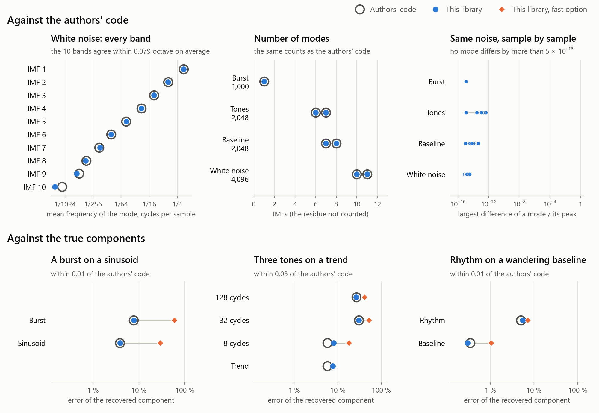

# VectorEMD

**ICEEMDAN (Improved Complete Ensemble Empirical Mode Decomposition with Adaptive Noise), EEMD and EMD in C++, with C and Python interfaces.** The repository, the CMake package and the Python module are named `iceemdan`.

It follows the published algorithm of Colominas et al. (2014), agrees with the authors' own code, and decomposes a signal of 1,024 samples with an ensemble of 100 in 8 ms on eight threads, where the authors' code takes 36 s. Every further signal of that length takes 4 ms.

[](https://opensource.org/licenses/MIT)

<picture>
  <source media="(prefers-color-scheme: dark)" srcset="docs/img/decomposition-dark.png">
  
</picture>

The test signal of the ICEEMDAN paper: a sinusoid with a short burst of a higher frequency, the standard example of mode mixing in plain EMD. Both codes put the burst in IMF 1 and stop there: what is left, the sinusoid, is already a mode and becomes the residue. Both are within 8 % of the true components.

## What is ICEEMDAN?

**Empirical Mode Decomposition (EMD)** splits a nonlinear, non-stationary signal into oscillatory components called Intrinsic Mode Functions (IMFs). It uses no predefined basis: the components come from the data. Its weakness is **mode mixing**: one IMF can hold very different frequencies, as the burst and the sinusoid above would.

| Method | Year | Idea | Limitation |
|--------|------|------|------------|
| **EMD** | Huang 1998 | Adaptive decomposition | Mode mixing |
| **EEMD** | Wu & Huang 2009 | Average the EMD of many noisy copies | Residual noise, incomplete decomposition |
| **CEEMDAN** | Torres 2011 | Add noise stage by stage | Spurious modes, residual noise |
| **ICEEMDAN** | Colominas 2014 | Average the local means of the noisy copies | Cleaner IMFs, complete decomposition |

ICEEMDAN averages the *local mean* of each noisy copy instead of its modes. The IMFs carry less noise, separate better in frequency, and add up to the signal exactly.

## Accuracy

The default configuration is the published algorithm as the authors' own code computes it (`ceemdan.m` with `emd.m`, run in GNU Octave), and it agrees with that code at the same settings:

<picture>
  <source media="(prefers-color-scheme: dark)" srcset="docs/img/accuracy-dark.png">
  
</picture>

<details>
<summary>The numbers</summary>

White noise, N = 4096: mean frequency of the first six modes, in cycles per sample.

| | IMF 1 | IMF 2 | IMF 3 | IMF 4 | IMF 5 | IMF 6 |
|---|---|---|---|---|---|---|
| Authors' code | 0.3421 | 0.1568 | 0.0788 | 0.0422 | 0.0201 | 0.0095 |
| This library | 0.3422 | 0.1568 | 0.0788 | 0.0422 | 0.0203 | 0.0095 |

Tones of 128, 32 and 8 cycles on a trend, N = 2048: relative error of the mode nearest each tone, edges excluded.

| | 128 cycles | 32 cycles | 8 cycles |
|---|---|---|---|
| Authors' code | 0.269 | 0.302 | 0.058 |
| This library | 0.265 | 0.306 | 0.080 |

</details>

The two codes draw different random numbers, so they agree statistically, not sample by sample. The modes and the residue add up to the signal to rounding (2 × 10⁻¹⁶). Method: [`validation/README.md`](validation/README.md).

## Speed


The authors' code (`ceemdan.m` with `emd.m`, at the same settings) ran in GNU Octave 11.3 on the same cores. Like the library's first signal of a length, it decomposes the noise of the ensemble on every call. The library keeps that noise, so further signals of the same length and settings skip the step, with the same result as they would get alone.

<details>
<summary>The numbers</summary>

Time per decomposition, ensemble of 100, default configuration:

| Signal length | Authors' code | First signal, 1 thread | First signal, 8 threads | Further signals, 1 thread | Further signals, 8 threads |
|---------------|---------------|------------------------|-------------------------|---------------------------|----------------------------|
| 1,024 | 35.7 s | 50.0 ms | 8.36 ms | 20.3 ms | 4.42 ms |
| 2,048 | 44.3 s | 110 ms | 18.7 ms | 40.8 ms | 7.52 ms |
| 4,096 | 64.9 s | 271 ms | 46.2 ms | 90.4 ms | 17.3 ms |
| 8,192 | 111 s | 739 ms | 116 ms | 207 ms | 36.6 ms |

Intel Core i9-14900KF, threads on the performance cores, built with GCC 16.2; median of 7 runs on a sum of tones for the library, the faster of 2 runs for the authors' code. The measurement is described in [`validation/figures/README.md`](validation/figures/README.md).

</details>

The speed options (a simpler stop rule, one envelope mean for each noisy copy, one shared noise decomposition) are 5 to 12 times faster again on further signals: 0.7 ms for 1,024 samples on 8 threads. They no longer reproduce the published algorithm.

## Features

**The decomposition**

- **ICEEMDAN as published**, by default, computed the way the authors' code computes it; EEMD and plain EMD as well.
- **Complete**: the IMFs and the residue add up to the signal to rounding.
- **Reproducible**: for a given seed, the same result bit for bit at any number of threads. The noise is the library's own (Philox4x32-10 and the inverse normal distribution function) and comes out the same bit for bit from GCC and MSVC, on Windows and Linux.
- **Three presets**: Standard, Scientific (no shortcuts, an audit trail) and Finance (Akima splines, noise scaled to the local volatility, causal boundaries, NaN and Inf cleaned from the input).
- **Envelopes**: cubic (not-a-knot), Akima or linear splines; symmetric, mirrored, autoregressive or linear boundary extension.
- **Made for batches**: the decomposed noise of the ensemble is kept between calls, so further signals of the same length take half the time or less.
- **Speed options** for when exact agreement with the paper matters less than time (among them ± noise pairs, which halve the noise to decompose), and a memory cap for the noise bank.
- **Diagnostics** for every IMF: sifting iterations, trials that did not converge, the number of trials averaged, the orthogonality index.
- **Analysis utilities**: Hilbert transform, instantaneous frequency, spectral entropy.

**The library**

- **Three interfaces**: C++17 headers, a C interface built as a shared library, and a Python binding on NumPy arrays.
- **Multithreaded without OpenMP**: the ensemble runs on the library's own thread pool. The thread count is one setting, and idle threads use no processor.
- **Little to install**: a C++17 compiler and CMake. The splines, the noise and the threads are the library's own; the one library it uses, [VectorFFT](https://github.com/Tugbars/VectorFFT) for the FFTs, is downloaded by CMake as a ready-built binary.
- **Windows and Linux** on x86-64 processors with AVX2. Developed and tested with GCC (MinGW included); it also builds with MSVC, and CMake has configurations for Clang and Intel ICX.
- **Tested**: regression tests run with `ctest`, and the validation against the authors' code is in the repository.

## References

1. **ICEEMDAN**: Colominas, M. A., Schlotthauer, G., & Torres, M. E. (2014). Improved complete ensemble EMD: A suitable tool for biomedical signal processing. *Biomedical Signal Processing and Control*, 14, 19-29.

2. **CEEMDAN**: Torres, M. E., Colominas, M. A., Schlotthauer, G., & Flandrin, P. (2011). A complete ensemble empirical mode decomposition with adaptive noise. *ICASSP 2011*.

3. **EEMD**: Wu, Z., & Huang, N. E. (2009). Ensemble empirical mode decomposition: a noise-assisted data analysis method. *Advances in Adaptive Data Analysis*, 1(01), 1-41.

4. **EMD**: Huang, N. E., et al. (1998). The empirical mode decomposition and the Hilbert spectrum for nonlinear and non-stationary time series analysis. *Proceedings of the Royal Society A*, 454(1971), 903-995.

5. **Sifting stop rule and boundary extension**: Rilling, G., Flandrin, P., & Gonçalves, P. (2003). On empirical mode decomposition and its algorithms. *IEEE-EURASIP Workshop on Nonlinear Signal and Image Processing (NSIP-03)*.

6. **Akima Splines**: Akima, H. (1970). A new method of interpolation and smooth curve fitting based on local procedures. *Journal of the ACM*, 17(4), 589-602.

7. **The noise generator**: Salmon, J. K., Moraes, M. A., Dror, R. O., & Shaw, D. E. (2011). Parallel random numbers: as easy as 1, 2, 3. *SC '11: Proceedings of the International Conference for High Performance Computing, Networking, Storage and Analysis*.

8. **The inverse normal distribution function**: Wichura, M. J. (1988). Algorithm AS 241: The percentage points of the normal distribution. *Applied Statistics*, 37(3), 477-484.

## Citation

If you use this implementation in your research, please cite:

```bibtex
@software{vectoremd,
  author = {Tugbars Heptaskin},
  title = {VectorEMD: ICEEMDAN, EEMD and EMD in C++},
  year = {2025},
  url = {https://github.com/Tugbars/iceemdan}
}
```

## License

MIT License. See [LICENSE](LICENSE) for details.

## Contributing

Contributions welcome! Please open an issue or PR.

## Acknowledgments

- Colominas, Schlotthauer and Torres for the ICEEMDAN algorithm and its reference code
- Rilling, Flandrin and Gonçalves for `emd.m`, whose stop rule and boundary extension the defaults follow
- [VectorFFT](https://github.com/Tugbars/VectorFFT) for the FFTs
