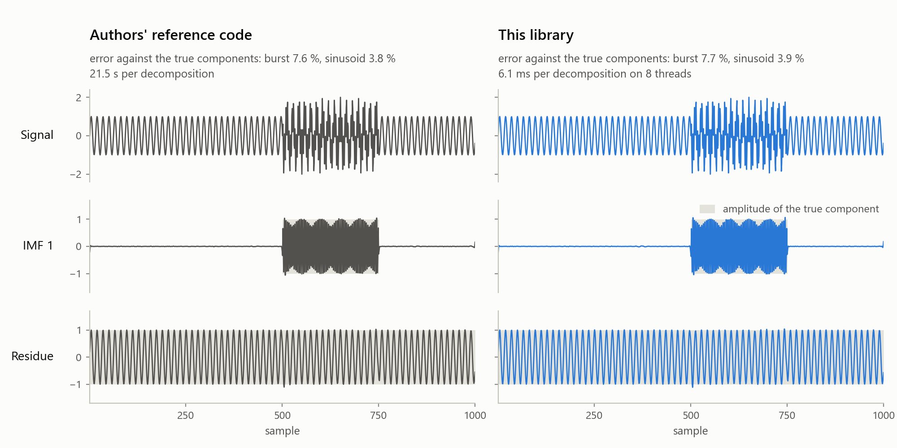

# ICEEMDAN-MKL

**Improved Complete Ensemble Empirical Mode Decomposition with Adaptive Noise (ICEEMDAN) in C++, with C and Python interfaces.**

It follows the published algorithm of Colominas et al. (2014), agrees with the authors' own code, and decomposes a signal of 1,024 samples with an ensemble of 100 in 24 ms on eight threads.

[](https://opensource.org/licenses/MIT)

<picture>
  <source media="(prefers-color-scheme: dark)" srcset="docs/img/decomposition-dark.png">
  
</picture>

The test signal of the ICEEMDAN paper: a sinusoid with a short burst of a higher frequency, the standard example of mode mixing in plain EMD. The library puts the burst in IMF 1 and the sinusoid in IMF 2, within 7.6 % and 4.2 % of the true components, and leaves next to nothing in the remaining modes.

## What is ICEEMDAN?

**Empirical Mode Decomposition (EMD)** splits a nonlinear, non-stationary signal into oscillatory components called Intrinsic Mode Functions (IMFs). It uses no predefined basis: the components come from the data. Its weakness is **mode mixing**: one IMF can hold very different frequencies, as the burst and the sinusoid above would.

| Method | Year | Idea | Limitation |
|--------|------|------|------------|
| **EMD** | Huang 1998 | Adaptive decomposition | Mode mixing |
| **EEMD** | Wu & Huang 2009 | Average the EMD of many noisy copies | Residual noise, incomplete decomposition |
| **CEEMDAN** | Torres 2011 | Add noise stage by stage | Spurious modes, residual noise |
| **ICEEMDAN** | Colominas 2014 | Average the local means of the noisy copies | Cleaner IMFs, complete decomposition |

ICEEMDAN averages the *local mean* of each noisy copy instead of its modes. The IMFs carry less noise, separate better in frequency, and add up to the signal exactly.

## Accuracy

The default configuration is the published algorithm, and it agrees with the authors' own code (`ceemdan.m` with `emd.m`, run in GNU Octave) at the same settings:

<picture>
  <source media="(prefers-color-scheme: dark)" srcset="docs/img/accuracy-dark.png">
  
</picture>

<details>
<summary>The numbers</summary>

White noise, N = 4096: mean frequency of the first six modes, in cycles per sample.

| | IMF 1 | IMF 2 | IMF 3 | IMF 4 | IMF 5 | IMF 6 |
|---|---|---|---|---|---|---|
| Authors' code | 0.3421 | 0.1568 | 0.0788 | 0.0422 | 0.0201 | 0.0095 |
| This library | 0.3421 | 0.1566 | 0.0787 | 0.0424 | 0.0202 | 0.0094 |

Tones of 128, 32 and 8 cycles on a trend, N = 2048: relative error of the mode nearest each tone, edges excluded.

| | 128 cycles | 32 cycles | 8 cycles |
|---|---|---|---|
| Authors' code | 0.269 | 0.302 | 0.058 |
| This library | 0.260 | 0.323 | 0.086 |

</details>

The two codes draw different random numbers, so they agree statistically, not sample by sample. The modes and the residue add up to the signal to rounding (2 × 10⁻¹⁶). Method: [`validation/README.md`](validation/README.md).

## Speed

Time per decomposition with an ensemble of 100, in the default configuration:

| Signal length | 1 thread | 8 threads |
|---------------|----------|-----------|
| 1,024 | 123 ms | 24 ms |
| 2,048 | 260 ms | 48 ms |
| 4,096 | 582 ms | 106 ms |
| 8,192 | 1,530 ms | 275 ms |

Measured on an Intel Core i9-14900KF, threads on the performance cores, built with GCC 16.2; median of 7 runs on a sum of tones. The measurement is described in [`validation/figures/README.md`](validation/figures/README.md).

The speed options (a simpler stop rule, one envelope mean for each noisy copy, one shared noise decomposition) are 5 to 15 times faster again: 4.7 ms for 1,024 samples on 8 threads. They no longer reproduce the published algorithm.

## Features

**The decomposition**

- **ICEEMDAN as published**, by default; EEMD and plain EMD as well.
- **Complete**: the IMFs and the residue add up to the signal to rounding.
- **Reproducible**: for a given seed, the same result bit for bit at any number of threads.
- **Three presets**: Standard, Scientific (no shortcuts, an audit trail) and Finance (Akima splines, noise scaled to the local volatility, causal boundaries, NaN and Inf cleaned from the input).
- **Envelopes**: cubic (not-a-knot), Akima or linear splines; symmetric, mirrored, autoregressive or linear boundary extension.
- **Speed options** for when exact agreement with the paper matters less than time, and a memory cap for the noise bank.
- **Diagnostics** for every IMF: sifting iterations, trials that did not converge, the number of trials averaged, the orthogonality index.
- **Analysis utilities**: Hilbert transform, instantaneous frequency, spectral entropy.

**The library**

- **Three interfaces**: C++17 headers, a C interface built as a shared library, and a Python binding on NumPy arrays.
- **Multithreaded without OpenMP**: the ensemble runs on the library's own thread pool. The thread count is one setting, and idle threads use no processor.
- **Little to install**: Intel MKL (splines and random numbers). The FFT library, [VectorFFT](https://github.com/Tugbars/VectorFFT), is downloaded by CMake as a ready-built binary.
- **Windows and Linux** on x86-64 processors with AVX2; builds with MSVC and GCC (MinGW included), with configurations for Clang and Intel ICX.
- **Tested**: regression tests run with `ctest`, and the validation against the authors' code is in the repository.

## References

1. **ICEEMDAN**: Colominas, M. A., Schlotthauer, G., & Torres, M. E. (2014). Improved complete ensemble EMD: A suitable tool for biomedical signal processing. *Biomedical Signal Processing and Control*, 14, 19-29.

2. **CEEMDAN**: Torres, M. E., Colominas, M. A., Schlotthauer, G., & Flandrin, P. (2011). A complete ensemble empirical mode decomposition with adaptive noise. *ICASSP 2011*.

3. **EEMD**: Wu, Z., & Huang, N. E. (2009). Ensemble empirical mode decomposition: a noise-assisted data analysis method. *Advances in Adaptive Data Analysis*, 1(01), 1-41.

4. **EMD**: Huang, N. E., et al. (1998). The empirical mode decomposition and the Hilbert spectrum for nonlinear and non-stationary time series analysis. *Proceedings of the Royal Society A*, 454(1971), 903-995.

5. **Sifting stop rule and boundary extension**: Rilling, G., Flandrin, P., & Gonçalves, P. (2003). On empirical mode decomposition and its algorithms. *IEEE-EURASIP Workshop on Nonlinear Signal and Image Processing (NSIP-03)*.

6. **Akima Splines**: Akima, H. (1970). A new method of interpolation and smooth curve fitting based on local procedures. *Journal of the ACM*, 17(4), 589-602.

## Citation

If you use this implementation in your research, please cite:

```bibtex
@software{iceemdan_mkl,
  author = {Tugbars Heptaskin},
  title = {ICEEMDAN-MKL: High-Performance ICEEMDAN Implementation},
  year = {2025},
  url = {https://github.com/Tugbars/iceemdan-mkl}
}
```

## License

MIT License. See [LICENSE](LICENSE) for details.

## Contributing

Contributions welcome! Please open an issue or PR.

## Acknowledgments

- Colominas, Schlotthauer and Torres for the ICEEMDAN algorithm and its reference code
- Rilling, Flandrin and Gonçalves for `emd.m`, whose stop rule and boundary extension the defaults follow
- Intel MKL for the splines and the random numbers
- [VectorFFT](https://github.com/Tugbars/VectorFFT) for the FFTs
